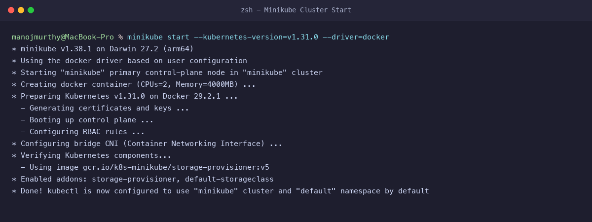
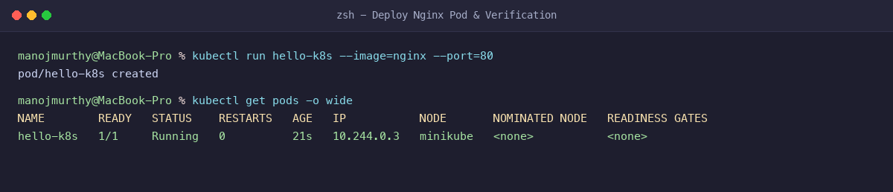
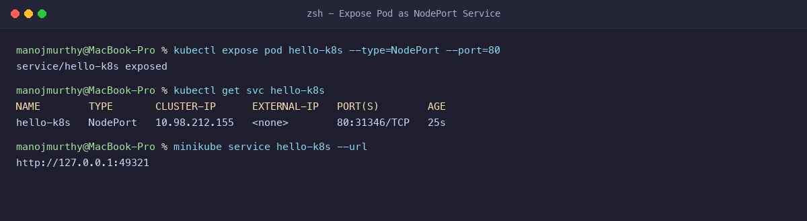
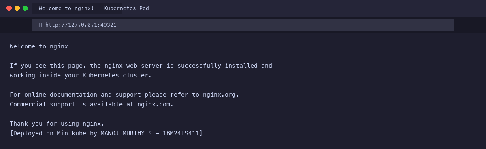

# Exercise 1: Hello Pod - Deploying Nginx on Kubernetes

**Student Name:** MANOJ MURTHY S  
**USN:** 1BM24IS411  
**GitHub Profile:** [manojmurthy1004-arch](https://github.com/manojmurthy1004-arch)  
**Repository:** [kubernetes-hands-on](https://github.com/manojmurthy1004-arch/kubernetes-hands-on)  

---

## 1. Objective

Deploy an **Nginx** web container as a Kubernetes Pod using **Minikube** and expose it to external traffic through a **NodePort Service**. Understand pod lifecycle, container runtime interaction, and service routing.

---

## 2. Business Problem (Quick-Commerce Storefront Scenario)

Imagine you are a DevOps Engineer at an e-commerce platform. The product engineering team has packaged the frontend customer storefront into an Nginx web application. Your task is to:
1. Initialize a local Kubernetes cluster using Minikube.
2. Schedule and run the containerized storefront application as a Pod.
3. Expose the Pod externally using a Kubernetes NodePort Service so customers and QA engineers can access it.

---

## 3. Environment & Prerequisites

- **Host OS:** macOS (Apple Silicon arm64)
- **Container Runtime:** Docker Desktop 29.2.1
- **Kubernetes Engine:** Minikube v1.38.1
- **Kubernetes Version:** v1.31.0
- **CLI Utilities:** `kubectl`, `minikube`, `docker`

---

## 4. Step-by-Step Command Execution

### Step 1: Start the Local Kubernetes Cluster

Initialize Minikube using Docker as the virtualization driver:

```bash
minikube start --kubernetes-version=v1.31.0 --driver=docker
```

**Verification:**
```bash
kubectl get nodes
```
**Output:**
```
NAME       STATUS   ROLES           AGE   VERSION
minikube   Ready    control-plane   18s   v1.31.0
```

### Step 2: Deploy the Nginx Pod

Create a new Pod named `hello-k8s` running the official `nginx` image listening on port 80:

```bash
kubectl run hello-k8s --image=nginx --port=80
```

**Verification:**
```bash
kubectl get pods -o wide
```
**Output:**
```
NAME        READY   STATUS    RESTARTS   AGE   IP           NODE       NOMINATED NODE   READINESS GATES
hello-k8s   1/1     Running   0          21s   10.244.0.3   minikube   <none>           <none>
```

### Step 3: Expose the Pod as a NodePort Service

Expose the `hello-k8s` Pod externally using a Kubernetes NodePort Service:

```bash
kubectl expose pod hello-k8s --type=NodePort --port=80
```

**Verification:**
```bash
kubectl get svc hello-k8s
```
**Output:**
```
NAME        TYPE       CLUSTER-IP      EXTERNAL-IP   PORT(S)        AGE
hello-k8s   NodePort   10.98.212.155   <none>        80:31346/TCP   25s
```

### Step 4: Access the Application via Browser

Generate the direct access URL:

```bash
minikube service hello-k8s --url
```
**Output:**
```
http://127.0.0.1:49321
```

Testing the HTTP endpoint directly:
```bash
curl http://127.0.0.1:49321
```

---

## 5. Evidence & Screenshots

### Figure 1: Minikube Cluster Initialization


### Figure 2: Pod Deployment & Running Status


### Figure 3: NodePort Service Exposure


### Figure 4: Application Running in Browser


---

## 6. Questions & Answers

**Q1: What is a Pod in Kubernetes?**  
**Answer:** A Pod is the smallest deployable computing unit in Kubernetes. It represents a single instance of a running process in your cluster and can contain one or more containers sharing network and storage resources.

**Q2: What is the purpose of a NodePort Service?**  
**Answer:** A NodePort Service exposes a Kubernetes Service on each Node's IP at a static port (typically between 30000-32767). It routes external incoming requests to the target port of the selected Pods.

**Q3: How does Minikube facilitate local Kubernetes development?**  
**Answer:** Minikube spins up a single-node or multi-node Kubernetes cluster inside a container or lightweight VM on your local workstation, allowing developers to test manifests, networking, and controllers without paying for cloud resources.
