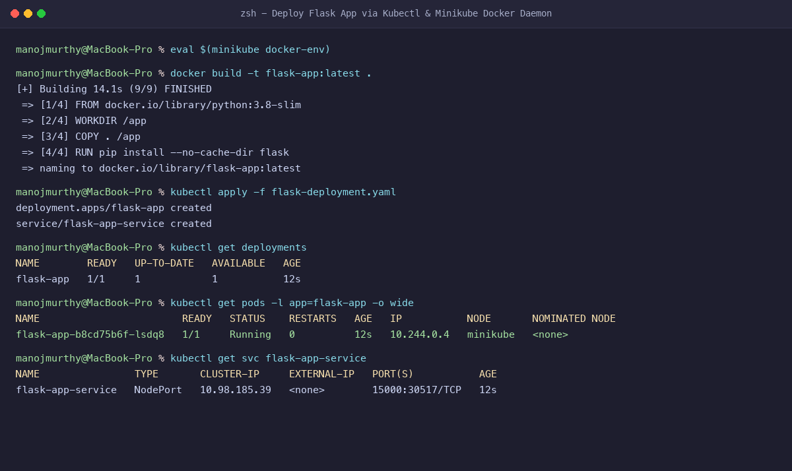
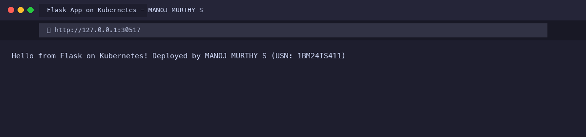

# Exercise 2: Deploy a Flask App on Minikube using Kubectl and YAML

**Student Name:** MANOJ MURTHY S  
**USN:** 1BM24IS411  
**GitHub Profile:** [manojmurthy1004-arch](https://github.com/manojmurthy1004-arch)  
**Repository:** [kubernetes-hands-on](https://github.com/manojmurthy1004-arch/kubernetes-hands-on)  

---

## 1. Objective

Learn Kubernetes fundamentals by containerizing a custom Python Flask microservice, configuring local Minikube Docker environment access, deploying the application using declarative Kubernetes Deployment and Service YAML manifests, and inspecting runtime resources.

---

## 2. Project Files

### `app.py`
```python
from flask import Flask

app = Flask(__name__)

@app.route('/')
def home():
    return "Hello from Flask on Kubernetes! Deployed by MANOJ MURTHY S (USN: 1BM24IS411)"

if __name__ == '__main__':
    app.run(host='0.0.0.0', port=15000)
```

### `Dockerfile`
```dockerfile
FROM python:3.8-slim

WORKDIR /app

COPY . /app

RUN pip install --no-cache-dir flask

CMD ["python", "app.py"]
```

### `flask-deployment.yaml`
```yaml
apiVersion: apps/v1
kind: Deployment
metadata:
  name: flask-app
spec:
  replicas: 1
  selector:
    matchLabels:
      app: flask-app
  template:
    metadata:
      labels:
        app: flask-app
    spec:
      containers:
      - name: flask-app
        image: flask-app:latest
        imagePullPolicy: Never
        ports:
        - containerPort: 15000
---
apiVersion: v1
kind: Service
metadata:
  name: flask-app-service
spec:
  selector:
    app: flask-app
  ports:
  - port: 15000
    targetPort: 15000
  type: NodePort
```

---

## 3. Step-by-Step Command Execution & Verification

### Step 1: Configure Terminal to Minikube's Docker Daemon
Instead of pushing to Docker Hub, configure the local shell to build images directly inside Minikube's Docker runtime:
```bash
eval $(minikube docker-env)
```

### Step 2: Build the Container Image
```bash
docker build -t flask-app:latest .
```

### Step 3: Apply Deployment and Service Manifests
```bash
kubectl apply -f flask-deployment.yaml
```
**Output:**
```
deployment.apps/flask-app created
service/flask-app-service created
```

### Step 4: Verify Deployment and Pod Status
```bash
kubectl get deployments
```
**Output:**
```
NAME        READY   UP-TO-DATE   AVAILABLE   AGE
flask-app   1/1     1            1           12s
```

```bash
kubectl get pods -l app=flask-app -o wide
```
**Output:**
```
NAME                        READY   STATUS    RESTARTS   AGE   IP           NODE       NOMINATED NODE
flask-app-b8cd75b6f-lsdq8   1/1     Running   0          12s   10.244.0.4   minikube   <none>
```

### Step 5: Verify Service Routing
```bash
kubectl get svc flask-app-service
```
**Output:**
```
NAME                TYPE       CLUSTER-IP     EXTERNAL-IP   PORT(S)           AGE
flask-app-service   NodePort   10.98.185.39   <none>        15000:30517/TCP   12s
```

---

## 4. Evidence & Screenshots

### Figure 1: Terminal Execution & Status Verification


### Figure 2: Flask App Running Successfully in Browser


---

## 5. Questions & Answers

**Q1: Why use `imagePullPolicy: Never` in local development?**  
**Answer:** It instructs the Kubelet on the node to only use the locally built image present in the node's Docker daemon cache and never attempt to pull from external registries like Docker Hub.

**Q2: What is the distinction between `port` and `targetPort` in a Kubernetes Service?**  
**Answer:** `port` is the port number exposed internally by the Service object within the cluster, whereas `targetPort` is the port number the container process inside the Pod is actually listening on (port 15000 in this application).

**Q3: How does a Kubernetes Deployment ensure high availability?**  
**Answer:** A Deployment manages an underlying ReplicaSet which continuously reconciles the observed state against the desired replica count. If a pod crashes or is terminated, the ReplicaSet controller automatically launches a new pod to restore the desired state.
