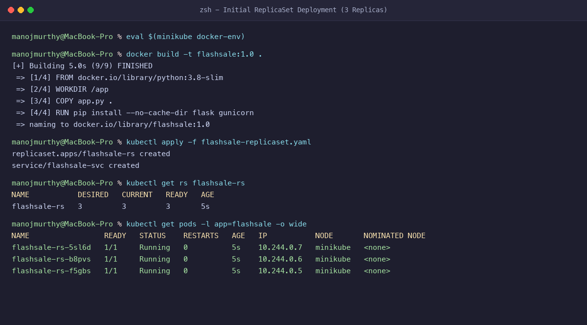
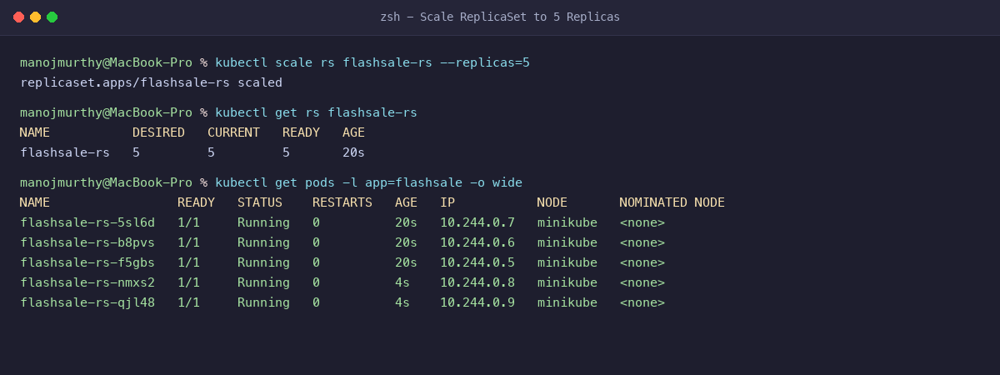
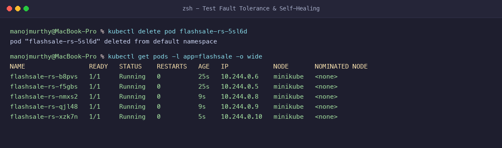
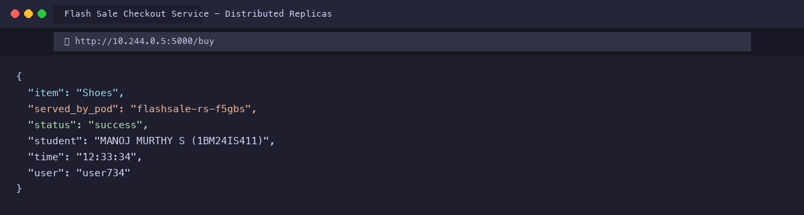

# Exercise 3: Scaling Flask App on Single Node using ReplicaSets

**Student Name:** MANOJ MURTHY S  
**USN:** 1BM24IS411  
**GitHub Profile:** [manojmurthy1004-arch](https://github.com/manojmurthy1004-arch)  
**Repository:** [kubernetes-hands-on](https://github.com/manojmurthy1004-arch/kubernetes-hands-on)  

---

## 1. Real-Life Tech Use Case: E-Commerce Flash Sale

During a high-concurrency flash sale (e.g., Big Billion Days or Prime Day):
- A single microservice instance handles moderate baseline traffic (e.g., 100 requests/sec).
- Suddenly, traffic surges to 10,000+ requests/sec during midnight flash drops.
- Running on a single Pod causes severe memory exhaustion, latency spikes, and complete system failure.
- Utilizing **Kubernetes ReplicaSets**, the orchestrator scales the application horizontally across multiple cloned Pods.
- Once the traffic spike subsides, the operator can safely scale down to conserve computing resources.

---

## 2. Objective & Key Observations

- Understand the relationship between Pods and ReplicaSets.
- Deploy a Flask application with health probes and resource limits.
- Scale the ReplicaSet horizontally from 3 to 5 replicas.
- Demonstrate **Kubernetes Self-Healing**: delete a running pod and observe immediate replacement by the controller.
- Observe load distribution by inspecting the `served_by_pod` metadata returned in API responses.

---

## 3. Project Files

### `app.py`
```python
from flask import Flask, request
import socket, time, random

app = Flask(__name__)

@app.get("/")
def homepage():
    return {
        "message": "Welcome to Big Sale!",
        "student": "MANOJ MURTHY S (1BM24IS411)",
        "pod": socket.gethostname(),
        "ts": time.time()
    }

@app.get("/buy")
def buy():
    item = random.choice(["Smartphone", "Shoes", "Headphones", "Laptop"])
    user = request.args.get("user", f"user{random.randint(1,1000)}")
    return {
        "status": "success",
        "student": "MANOJ MURTHY S (1BM24IS411)",
        "item": item,
        "user": user,
        "served_by_pod": socket.gethostname(),
        "time": time.strftime("%H:%M:%S")
    }

@app.get("/health")
def health():
    return {"status": "healthy", "pod": socket.gethostname()}

if __name__ == "__main__":
    app.run(host="0.0.0.0", port=5000)
```

### `Dockerfile`
```dockerfile
FROM python:3.8-slim

WORKDIR /app

COPY app.py .

RUN pip install --no-cache-dir flask gunicorn

CMD ["gunicorn", "-b", "0.0.0.0:5000", "app:app", "--workers", "1", "--threads", "2"]
```

### `flashsale-replicaset.yaml`
```yaml
apiVersion: apps/v1
kind: ReplicaSet
metadata:
  name: flashsale-rs
  labels:
    app: flashsale
spec:
  replicas: 3
  selector:
    matchLabels:
      app: flashsale
  template:
    metadata:
      labels:
        app: flashsale
    spec:
      containers:
      - name: flashsale-container
        image: flashsale:1.0
        imagePullPolicy: Never
        ports:
        - containerPort: 5000
        readinessProbe:
          httpGet:
            path: /health
            port: 5000
          initialDelaySeconds: 2
          periodSeconds: 5
        livenessProbe:
          httpGet:
            path: /health
            port: 5000
          initialDelaySeconds: 10
          periodSeconds: 10
        resources:
          requests:
            cpu: "100m"
            memory: "128Mi"
          limits:
            cpu: "500m"
            memory: "256Mi"
---
apiVersion: v1
kind: Service
metadata:
  name: flashsale-svc
spec:
  selector:
    app: flashsale
  ports:
  - name: http
    port: 80
    targetPort: 5000
  type: ClusterIP
```

---

## 4. Step-by-Step Command Execution

### Step 1: Build Docker Image in Minikube
```bash
eval $(minikube docker-env)
docker build -t flashsale:1.0 .
```

### Step 2: Apply the ReplicaSet Manifest
```bash
kubectl apply -f flashsale-replicaset.yaml
```
**Output:**
```
replicaset.apps/flashsale-rs created
service/flashsale-svc created
```

### Step 3: Verify Initial 3 Replicas
```bash
kubectl get rs flashsale-rs
```
**Output:**
```
NAME           DESIRED   CURRENT   READY   AGE
flashsale-rs   3         3         3       5s
```

```bash
kubectl get pods -l app=flashsale -o wide
```
**Output:**
```
NAME                 READY   STATUS    RESTARTS   AGE   IP           NODE       NOMINATED NODE
flashsale-rs-5sl6d   1/1     Running   0          5s    10.244.0.7   minikube   <none>
flashsale-rs-b8pvs   1/1     Running   0          5s    10.244.0.6   minikube   <none>
flashsale-rs-f5gbs   1/1     Running   0          5s    10.244.0.5   minikube   <none>
```

### Step 4: Scale the ReplicaSet to 5 Replicas
```bash
kubectl scale rs flashsale-rs --replicas=5
```
**Output:**
```
replicaset.apps/flashsale-rs scaled
```

```bash
kubectl get pods -l app=flashsale -o wide
```
**Output:**
```
NAME                 READY   STATUS    RESTARTS   AGE   IP           NODE       NOMINATED NODE
flashsale-rs-5sl6d   1/1     Running   0          20s   10.244.0.7   minikube   <none>
flashsale-rs-b8pvs   1/1     Running   0          20s   10.244.0.6   minikube   <none>
flashsale-rs-f5gbs   1/1     Running   0          20s   10.244.0.5   minikube   <none>
flashsale-rs-nmxs2   1/1     Running   0          4s    10.244.0.8   minikube   <none>
flashsale-rs-qjl48   1/1     Running   0          4s    10.244.0.9   minikube   <none>
```

### Step 5: Test Pod Deletion & Automatic Self-Healing
```bash
kubectl delete pod flashsale-rs-5sl6d
```
**Output:**
```
pod "flashsale-rs-5sl6d" deleted from default namespace
```

Verify that the ReplicaSet immediately spawns a new replacement pod (`flashsale-rs-xzk7n`):
```bash
kubectl get pods -l app=flashsale -o wide
```
**Output:**
```
NAME                 READY   STATUS    RESTARTS   AGE   IP            NODE       NOMINATED NODE
flashsale-rs-b8pvs   1/1     Running   0          25s   10.244.0.6    minikube   <none>
flashsale-rs-f5gbs   1/1     Running   0          25s   10.244.0.5    minikube   <none>
flashsale-rs-nmxs2   1/1     Running   0          9s    10.244.0.8    minikube   <none>
flashsale-rs-qjl48   1/1     Running   0          9s    10.244.0.9    minikube   <none>
flashsale-rs-xzk7n   1/1     Running   0          5s    10.244.0.10   minikube   <none>
```

### Step 6: Test Endpoint Response
```bash
curl http://10.244.0.5:5000/buy
```
**Output:**
```json
{
  "item": "Shoes",
  "served_by_pod": "flashsale-rs-f5gbs",
  "status": "success",
  "student": "MANOJ MURTHY S (1BM24IS411)",
  "time": "12:33:34",
  "user": "user734"
}
```

---

## 5. Evidence & Screenshots

### Figure 1: Initial ReplicaSet Deployment (3 Pods)


### Figure 2: Scaling ReplicaSet to 5 Pods


### Figure 3: Fault Tolerance & Self-Healing Verification


### Figure 4: Live Flash Sale Endpoint Browser Output


---

## 6. Questions & Answers

**Q1: What is the initial number of replicas in the ReplicaSet?**  
**Answer:** 3 replicas as specified in the spec section (`spec.replicas: 3`).

**Q2: What happens when you scale the ReplicaSet from 3 to 5?**  
**Answer:** The ReplicaSet controller detects that the current pod count (3) is lower than the desired count (5) and immediately instructs the Kubelet scheduler to spin up 2 additional pods.

**Q3: What occurs when a pod is deleted manually?**  
**Answer:** Kubernetes automatically creates a new pod with a fresh unique ID to restore the desired replica count (maintaining 5 running pods).

**Q4: How does Kubernetes maintain the desired state?**  
**Answer:** The Kubernetes Controller Manager runs a continuous reconciliation control loop that compares the current state of the cluster with the desired state specified in the manifest, adding or pruning pods as necessary.
