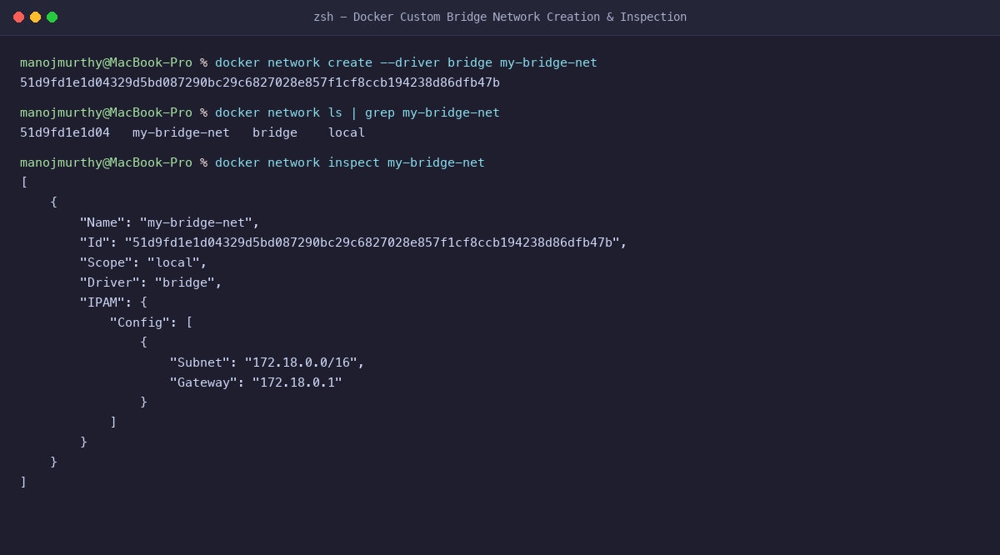
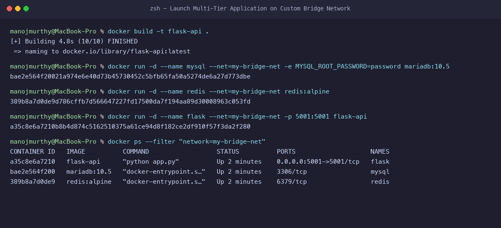
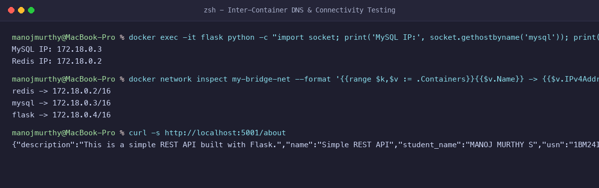
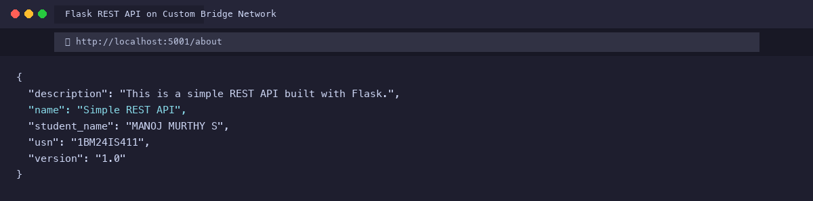

# Exercise 4: Docker Networking with Multiple Containers

**Student Name:** MANOJ MURTHY S  
**USN:** 1BM24IS411  
**GitHub Profile:** [manojmurthy1004-arch](https://github.com/manojmurthy1004-arch)  
**Repository:** [kubernetes-hands-on](https://github.com/manojmurthy1004-arch/kubernetes-hands-on)  

---

## 1. Objective

Understand Docker networking architecture by designing and establishing an isolated user-defined **bridge network**. Deploy a multi-tier microservice architecture consisting of:
1. **Flask Web API** (Container 1 - Application Tier)
2. **MySQL Database** (Container 2 - Persistence Tier)
3. **Redis Cache** (Container 3 - In-Memory Cache Tier)

Verify automatic service discovery, inter-container name resolution, and external port forwarding.

---

## 2. Architecture & Scenario

In production microservices, containers should not run on the default bridge network because default bridge lacks automatic DNS resolution between containers. Creating a user-defined bridge network (`my-bridge-net`) provides:
- Automatic embedded DNS resolution (containers resolve each other directly by container name).
- Network isolation (only containers connected to `my-bridge-net` can talk to each other).
- Granular ingress control (only the web tier exposes port 5001 to the host).

---

## 3. Project Files

### `app.py`
```python
from flask import Flask, jsonify

app = Flask(__name__)

@app.route('/about', methods=['GET'])
def about():
    return jsonify({
        "student_name": "MANOJ MURTHY S",
        "usn": "1BM24IS411",
        "name": "Simple REST API",
        "version": "1.0",
        "description": "This is a simple REST API built with Flask."
    })

if __name__ == '__main__':
    app.run(host='0.0.0.0', port=5001)
```

### `requirements.txt`
```
Flask==2.2.5
Werkzeug==2.2.2
```

### `Dockerfile`
```dockerfile
FROM python:3.9-slim

WORKDIR /app

COPY requirements.txt .
COPY app.py .

RUN pip install --no-cache-dir -r requirements.txt

EXPOSE 5001

CMD ["python", "app.py"]
```

---

## 4. Step-by-Step Command Execution

### Task 1: Create a Custom Bridge Network
```bash
docker network create --driver bridge my-bridge-net
```
**Output:**
```
51d9fd1e1d04329d5bd087290bc29c6827028e857f1cf8ccb194238d86dfb47b
```

### Task 2: Inspect the Network
```bash
docker network inspect my-bridge-net
```
**Network Subnet Allocated:** `172.18.0.0/16`, Gateway: `172.18.0.1`.

### Task 3: Build the Flask API Image
```bash
docker build -t flask-api .
```

### Task 4: Launch Multi-Tier Containers on `my-bridge-net`
```bash
# Launch MySQL
docker run -d --name mysql --net=my-bridge-net -e MYSQL_ROOT_PASSWORD=password mariadb:10.5

# Launch Redis
docker run -d --name redis --net=my-bridge-net redis:alpine

# Launch Flask API with port mapping
docker run -d --name flask --net=my-bridge-net -p 5001:5001 flask-api
```

**Verification:**
```bash
docker ps --filter "network=my-bridge-net"
```
**Output:**
```
CONTAINER ID   IMAGE          COMMAND                  STATUS          PORTS                    NAMES
a35c8e6a7210   flask-api      "python app.py"          Up 2 minutes    0.0.0.0:5001->5001/tcp   flask
bae2e564f200   mariadb:10.5   "docker-entrypoint.s…"   Up 2 minutes    3306/tcp                 mysql
389b8a7d0de9   redis:alpine   "docker-entrypoint.s…"   Up 2 minutes    6379/tcp                 redis
```

### Task 5: Verify Inter-Container DNS & Connectivity
Inside the Flask container, resolve peer containers by name:
```bash
docker exec -it flask python -c "import socket; print('MySQL IP:', socket.gethostbyname('mysql')); print('Redis IP:', socket.gethostbyname('redis'))"
```
**Output:**
```
MySQL IP: 172.18.0.3
Redis IP: 172.18.0.2
```

Query the Flask REST API from host:
```bash
curl -s http://localhost:5001/about
```
**Output:**
```json
{
  "description": "This is a simple REST API built with Flask.",
  "name": "Simple REST API",
  "student_name": "MANOJ MURTHY S",
  "usn": "1BM24IS411",
  "version": "1.0"
}
```

---

## 5. Evidence & Screenshots

### Figure 1: Bridge Network Creation & IPAM Inspection


### Figure 2: Launching Multi-Tier Containers


### Figure 3: DNS Resolution & Inter-Container Communication


### Figure 4: Live REST API Browser Output


---

## 6. Questions & Answers

**Q1: What is the purpose of the `--net` flag in `docker run`?**  
**Answer:** The `--net` (or `--network`) flag attaches the newly created container to a specific Docker network, placing it in the same broadcast domain as other containers on that network.

**Q2: How do containers communicate with each other on a user-defined bridge network?**  
**Answer:** Docker runs an embedded DNS server at `127.0.0.11` inside each container connected to a user-defined network. When a container queries the hostname of another container (e.g. `mysql`), the DNS server resolves it to its allocated IP address automatically.

**Q3: What is the difference between a bridge network and a host network?**  
**Answer:**
- **Bridge Network:** Containers run in isolated network namespaces with private IP addresses, communicating via virtual ethernet pairs (`veth`). External ports must be explicitly forwarded.
- **Host Network:** Containers share the host's actual network stack directly with no namespace isolation, eliminating NAT overhead but sharing the host's port namespace.

**Q4: How do you safely clean up the network environment?**  
**Answer:**
```bash
docker stop mysql redis flask && docker rm mysql redis flask
docker network rm my-bridge-net
```
