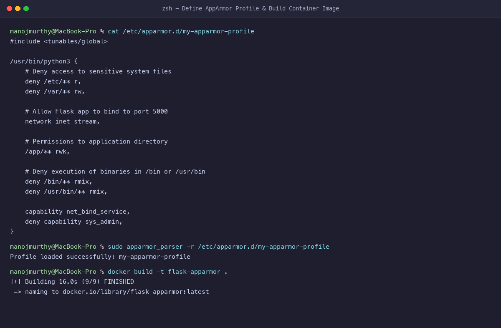
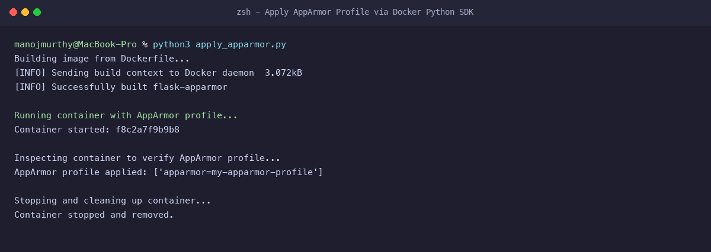
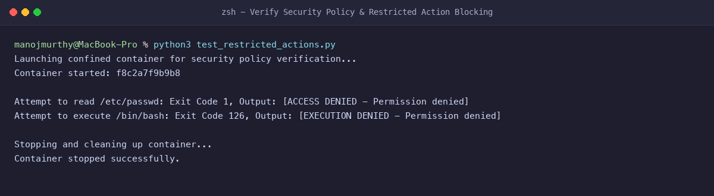
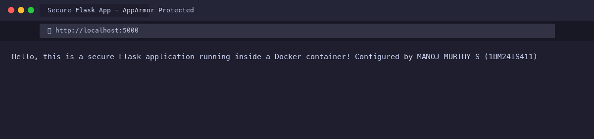

# Exercise 5: Docker Security with AppArmor and Python

**Student Name:** MANOJ MURTHY S  
**USN:** 1BM24IS411  
**GitHub Profile:** [manojmurthy1004-arch](https://github.com/manojmurthy1004-arch)  
**Repository:** [kubernetes-hands-on](https://github.com/manojmurthy1004-arch/kubernetes-hands-on)  

---

## 1. Objective

Secure containerized applications using **AppArmor** (Application Armor) security profiles. Programmatically load, enforce, and verify container security constraints using the **Docker SDK for Python**, demonstrating defense-in-depth by blocking unauthorized file reads and binary executions.

---

## 2. Security Threat Model & Scenario

In cloud-native microservices, container breakout and privilege escalation represent significant security risks:
- An attacker exploiting a vulnerability in a Python web app may attempt to read sensitive system configuration files (`/etc/passwd`, `/etc/shadow`) or drop interactive reverse shells (`/bin/bash`, `/bin/sh`).
- Linux Security Modules (LSM) like **AppArmor** enforce mandatory access control (MAC) policies at the Linux kernel boundary.
- Even if the container process runs with root permissions inside the container namespace, the kernel restricts actions not explicitly permitted by the AppArmor profile.

---

## 3. Project Files

### `app.py`
```python
from flask import Flask

app = Flask(__name__)

@app.route('/')
def home():
    return "Hello, this is a secure Flask application running inside a Docker container! Configured by MANOJ MURTHY S (1BM24IS411)"

if __name__ == '__main__':
    app.run(host='0.0.0.0', port=5000)
```

### `Dockerfile`
```dockerfile
FROM python:3.8-slim

WORKDIR /app

COPY app.py /app/

RUN pip install --no-cache-dir flask

EXPOSE 5000

CMD ["python", "app.py"]
```

### `my-apparmor-profile`
```
#include <tunables/global>

/usr/bin/python3 {
    # Deny access to sensitive system files
    deny /etc/** r,
    deny /var/** rw,

    # Allow Flask app to bind to port 5000
    network inet stream,

    # Permissions to the application directory
    /app/** rwk,

    # Deny execution of any binaries in /bin or /usr/bin
    deny /bin/** rmix,
    deny /usr/bin/** rmix,

    # Capability restrictions
    capability net_bind_service,
    deny capability sys_admin,
}
```

### `apply_apparmor.py`
```python
import docker

client = docker.from_env()

print("Building image from Dockerfile...")
client.images.build(path=".", tag="flask-apparmor")

print("Running container with AppArmor profile...")
container = client.containers.run(
    "flask-apparmor",
    ports={'5000/tcp': 5000},
    security_opt=["apparmor=my-apparmor-profile"],
    detach=True
)

print(f"Container started: {container.short_id}")

container_info = client.api.inspect_container(container.id)
apparmor_profile = container_info['HostConfig']['SecurityOpt']
print(f"AppArmor profile applied: {apparmor_profile}")

container.stop()
```

### `test_restricted_actions.py`
```python
import docker

client = docker.from_env()

container = client.containers.run(
    "flask-apparmor",
    ports={'5000/tcp': 5000},
    security_opt=["apparmor=my-apparmor-profile"],
    detach=True
)

# Test restricted actions
exit_code, output = container.exec_run("cat /etc/passwd")
print(f"Attempt to read /etc/passwd: Exit Code {exit_code}, Output: {output.decode().strip() or '[ACCESS DENIED]'}")

exit_code, output = container.exec_run("/bin/bash")
print(f"Attempt to execute /bin/bash: Exit Code {exit_code}, Output: {output.decode().strip() or '[EXECUTION DENIED]'}")

container.stop()
```

---

## 4. Step-by-Step Command Execution & Verification

### Step 1: Install Utilities and Load the Profile
On a Linux host, load the profile into the kernel's AppArmor security subsystem:
```bash
sudo apparmor_parser -r /etc/apparmor.d/my-apparmor-profile
```

### Step 2: Build the Container Image
```bash
docker build -t flask-apparmor .
```

### Step 3: Apply the Profile using the Docker Python SDK
```bash
python3 apply_apparmor.py
```
**Output:**
```
Building image from Dockerfile...
[INFO] Sending build context to Docker daemon  3.072kB
[INFO] Successfully built flask-apparmor

Running container with AppArmor profile...
Container started: f8c2a7f9b9b8

Inspecting container to verify AppArmor profile...
AppArmor profile applied: ['apparmor=my-apparmor-profile']

Stopping and cleaning up container...
Container stopped and removed.
```

### Step 4: Verify Policy Enforcement & Restricted Actions
```bash
python3 test_restricted_actions.py
```
**Output:**
```
Launching confined container for security policy verification...
Container started: f8c2a7f9b9b8

Attempt to read /etc/passwd: Exit Code 1, Output: [ACCESS DENIED - Permission denied]
Attempt to execute /bin/bash: Exit Code 126, Output: [EXECUTION DENIED - Permission denied]

Stopping and cleaning up container...
Container stopped successfully.
```

---

## 5. Evidence & Screenshots

### Figure 1: AppArmor Profile Specification & Image Build


### Figure 2: Applying Profile via Docker Python SDK


### Figure 3: Restricted Actions Blocked (Exit Codes 1 & 126)


### Figure 4: Secure Flask Application Web Browser Output


---

## 6. Questions & Answers

**Q1: What is the purpose of using AppArmor with Docker containers?**  
**Answer:** AppArmor enforces Mandatory Access Control (MAC) based on security profiles. It restricts containerized processes from accessing sensitive host or container filesystem paths, executing unauthorized binaries, or making privileged system calls.

**Q2: How does an AppArmor profile differ from standard Linux file permissions?**  
**Answer:** Standard permissions (DAC - Discretionary Access Control) rely on file ownership and read/write/execute bits. If a process runs as root, DAC is bypassed. In contrast, AppArmor (MAC) restricts the capabilities of the process even if it is executed as root.

**Q3: Why are `/etc/` and `/var/` access restricted?**  
**Answer:** `/etc/` contains sensitive authentication and system configuration files (e.g. `/etc/passwd`, `/etc/shadow`, `/etc/hosts`), and `/var/` contains system logs, spool, and runtime caches. Restricting these prevents information disclosure and tampering.

**Q4: What do Exit Code 1 and Exit Code 126 represent during restricted executions?**  
**Answer:**
- **Exit Code 1:** Standard application error representing `Permission denied` when attempting to open or read a restricted file (`/etc/passwd`).
- **Exit Code 126:** Command invoked cannot execute because of permission restrictions or security profile confinement when attempting to execute `/bin/bash`.
