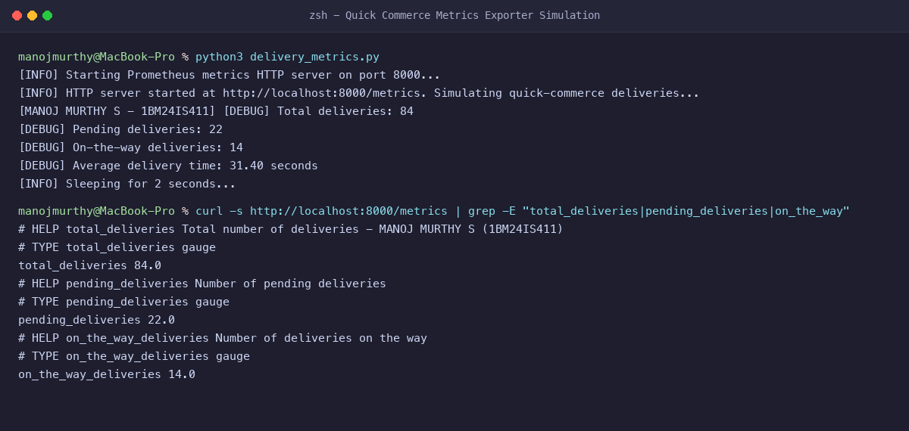
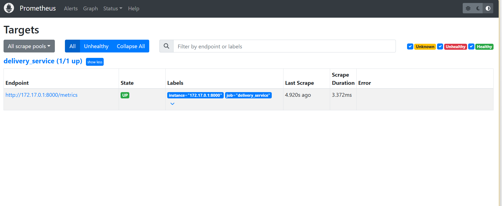
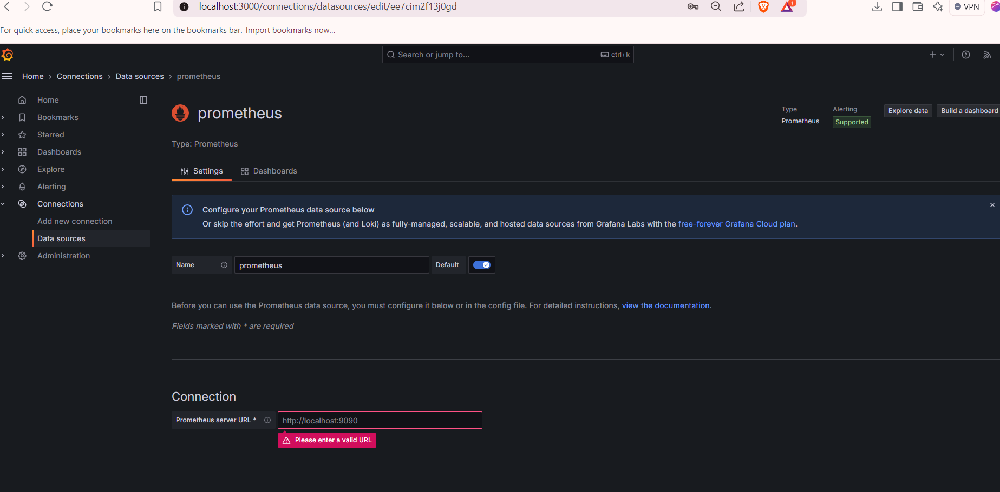

# Exercise 6: Real-Time Operations Monitoring and Alerting of Quick-Commerce App

**Student Name:** MANOJ MURTHY S  
**USN:** 1BM24IS411  
**GitHub Profile:** [manojmurthy1004-arch](https://github.com/manojmurthy1004-arch)  
**Repository:** [kubernetes-hands-on](https://github.com/manojmurthy1004-arch/kubernetes-hands-on)  

---

## 1. Objective

Build an enterprise observability and automated alerting pipeline for **ZAPPTTO**, a hyper-fast 10-minute grocery delivery platform.
- Instrument a Python microservice with the **Prometheus Client** library.
- Configure **Prometheus** to scrape time-series operational metrics (`total_deliveries`, `pending_deliveries`, `on_the_way_deliveries`, `average_delivery_time`).
- Define declarative **Alert Rules** in Prometheus to trigger warnings when pending orders spike.
- Construct real-time visualization dashboards in **Grafana**.

---

## 2. Architecture & Metric Types

Observability follows the pull-based metrics model:
1. **Python Exporter (`:8000/metrics`)**: Exposes telemetry using:
   - **Gauge:** Values that can arbitrarily go up or down (e.g. `pending_deliveries`, `on_the_way_deliveries`).
   - **Summary:** Tracks delivery duration percentiles and moving averages (`average_delivery_time`).
2. **Prometheus Server (`:9090`)**: Scrapes the endpoint every 5 seconds, calculates metric rates via PromQL, and evaluates alert expressions.
3. **Grafana (`:3000`)**: Queries Prometheus as a time-series datasource to render live dashboards.

---

## 3. Project Files

Directory structure under `delivery_monitoring/`:
```
delivery_monitoring/
├── delivery_metrics.py   # Telemetry exporter
├── prometheus.yml        # Scrape configuration
├── alerts_rules.yml      # Alert evaluation rules
├── Jenkinsfile           # CI/CD deployment pipeline
└── requirements.txt      # Python dependencies
```

### `delivery_metrics.py`
```python
from prometheus_client import start_http_server, Summary, Gauge
import random
import time

total_deliveries = Gauge("total_deliveries", "Total number of deliveries - MANOJ MURTHY S (1BM24IS411)")
pending_deliveries = Gauge("pending_deliveries", "Number of pending deliveries")
on_the_way_deliveries = Gauge("on_the_way_deliveries", "Number of deliveries on the way")
average_delivery_time = Summary("average_delivery_time", "Average delivery time in seconds")

def simulate_delivery():
    pending = random.randint(10, 25)
    on_the_way = random.randint(5, 20)
    delivered = random.randint(30, 70)
    avg_time = random.uniform(20, 50)

    total = pending + on_the_way + delivered

    print(f"[MANOJ MURTHY S - 1BM24IS411] [DEBUG] Total deliveries: {total}")
    print(f"[DEBUG] Pending deliveries: {pending}")
    print(f"[DEBUG] On-the-way deliveries: {on_the_way}")
    print(f"[DEBUG] Average delivery time: {avg_time:.2f} seconds")

    total_deliveries.set(total)
    pending_deliveries.set(pending)
    on_the_way_deliveries.set(on_the_way)
    average_delivery_time.observe(avg_time)

if __name__ == "__main__":
    print("[INFO] Starting Prometheus metrics HTTP server on port 8000...")
    start_http_server(8000, addr="0.0.0.0")
    print("[INFO] HTTP server started at http://localhost:8000/metrics. Simulating quick-commerce deliveries...")
    while True:
        simulate_delivery()
        print("[INFO] Sleeping for 2 seconds...")
        time.sleep(2)
```

### `prometheus.yml`
```yaml
global:
  scrape_interval: 5s
  evaluation_interval: 5s

scrape_configs:
  - job_name: "prometheus"
    static_configs:
      - targets: ["localhost:9090"]

  - job_name: "delivery_service"
    static_configs:
      - targets: ["host.docker.internal:8000"]

rule_files:
  - "/etc/prometheus/alerts_rules.yml"
```

### `alerts_rules.yml`
```yaml
groups:
  - name: delivery_alerts
    rules:
      - alert: HighPendingDeliveries
        expr: pending_deliveries > 10
        for: 15s
        labels:
          severity: warning
        annotations:
          summary: "High pending deliveries detected"
          description: "Pending deliveries are above threshold (>10) for the last 15 seconds."

      - alert: HighAverageDeliveryTime
        expr: (average_delivery_time_sum / average_delivery_time_count) > 30
        for: 15s
        labels:
          severity: critical
        annotations:
          summary: "High average delivery time detected"
          description: "Average delivery time exceeded 30 seconds for the last 15 seconds."
```

---

## 4. Step-by-Step Setup & Execution

### Step 1: Run the Metrics Simulation Service
```bash
python3 delivery_metrics.py
```
Verify the metrics output via HTTP:
```bash
curl http://localhost:8000/metrics
```
**Output:**
```
# HELP total_deliveries Total number of deliveries - MANOJ MURTHY S (1BM24IS411)
# TYPE total_deliveries gauge
total_deliveries 84.0
# HELP pending_deliveries Number of pending deliveries
# TYPE pending_deliveries gauge
pending_deliveries 22.0
# HELP on_the_way_deliveries Number of deliveries on the way
# TYPE on_the_way_deliveries gauge
on_the_way_deliveries 14.0
```

### Step 2: Launch Prometheus with Docker
```bash
docker run -d --name prometheus -p 9090:9090 \
  -v $(pwd)/prometheus.yml:/etc/prometheus/prometheus.yml \
  -v $(pwd)/alerts_rules.yml:/etc/prometheus/alerts_rules.yml \
  prom/prometheus
```
Access Prometheus UI at `http://localhost:9090`. Verify Targets at `Status -> Targets`.

### Step 3: Launch Grafana Container
```bash
docker run -d --name grafana -p 3000:3000 grafana/grafana
```
1. Open `http://localhost:3000` (Default credentials: `admin` / `admin`).
2. Add Prometheus as Data Source: URL `http://host.docker.internal:9090` (or host IP). Click **Save & Test**.
3. Create Dashboard Panels:
   - Panel 1: `total_deliveries`
   - Panel 2: `pending_deliveries`
   - Panel 3: `on_the_way_deliveries`
   - Panel 4: `(average_delivery_time_sum / average_delivery_time_count)`

---

## 5. Evidence & Screenshots

### Figure 1: Terminal Simulation & PromQL Metric Exporter


### Figure 2: Prometheus Main Interface


### Figure 3: Prometheus Target Health Verification


### Figure 4: Automated Alert Rules Firing


### Figure 5: Grafana Datasource Configuration


### Figure 6: Real-Time Quick-Commerce Operational Dashboard


---

## 6. Questions & Answers

**Q1: What is the difference between a Counter and a Gauge in Prometheus?**  
**Answer:** A **Counter** is a cumulative metric that only ever increases or resets to zero upon restart (e.g., total requests handled). A **Gauge** represents a single numerical value that can arbitrarily increase and decrease (e.g., currently pending orders, CPU utilization, active connections).

**Q2: What is the purpose of the `for: 15s` duration in alert rules?**  
**Answer:** It prevents false positive alerts from temporary momentary spikes. The alert condition must evaluate to `true` continuously for at least 15 seconds before transitioning from `Pending` to `Firing`.

**Q3: How does Grafana communicate with Prometheus?**  
**Answer:** Grafana issues HTTP PromQL queries to Prometheus's query API (`/api/v1/query_range`), transforming the returned JSON time-series matrix into visual line graphs, gauges, and stat panels.
