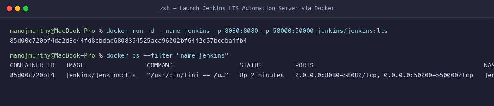
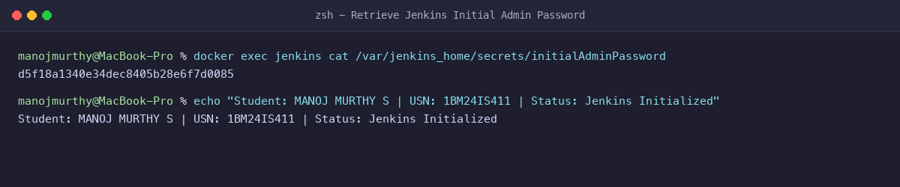
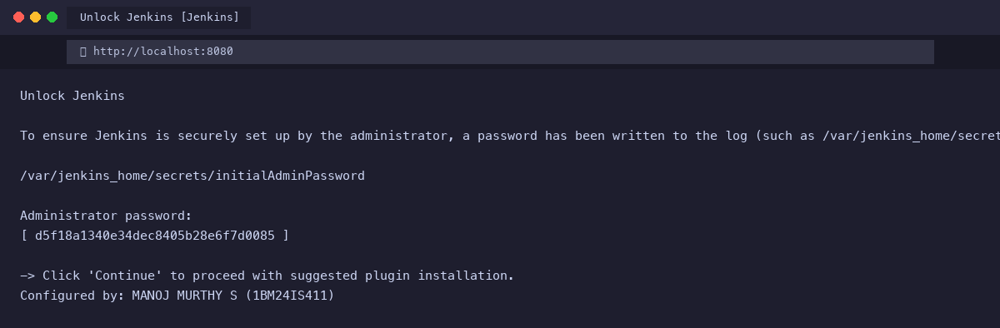
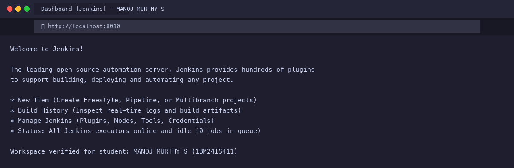

# Exercise 7: Introduction to Continuous Integration (CI) and Jenkins Setup

**Student Name:** MANOJ MURTHY S  
**USN:** 1BM24IS411  
**GitHub Profile:** [manojmurthy1004-arch](https://github.com/manojmurthy1004-arch)  
**Repository:** [kubernetes-hands-on](https://github.com/manojmurthy1004-arch/kubernetes-hands-on)  

---

## 1. Objective

Understand the principles, architecture, and benefits of **Continuous Integration (CI)** in modern DevOps culture. Deploy an enterprise-grade automation server (**Jenkins LTS**) using containerization, retrieve the generated administrative bootstrap credentials, and initialize the build execution environment.

---

## 2. What is Continuous Integration (CI)?

Continuous Integration is a software engineering practice where developers merge their working copies into a central shared mainline multiple times per day. Every commit triggers an automated build and test sequence to catch regression bugs as early as possible.

### Key Pillars of CI:
1. **Frequent Code Commits:** Small, incremental pull requests instead of monolithic branch merges.
2. **Automated Verification:** Every commit triggers a headless build and execution of automated unit/integration suites.
3. **Immediate Feedback:** Developers receive test pass/fail alerts within minutes of pushing code.
4. **Reproducible Build Environments:** Ephemeral build agents ensure builds are deterministic across machines.

---

## 3. Comparison of 10 Modern CI/CD Platforms

| Tool | Architecture | Configuration Format | Primary Use Case |
|---|---|---|---|
| **Jenkins** | Master / Agent (Self-Hosted) | Groovy / Declarative `Jenkinsfile` | Highly customizable enterprise CI/CD pipelines |
| **GitHub Actions** | Cloud / Self-Hosted Runners | YAML (`.github/workflows`) | Native GitHub integration and marketplace actions |
| **GitLab CI/CD** | Cloud / GitLab Runner | YAML (`.gitlab-ci.yml`) | All-in-one DevOps lifecycle within GitLab |
| **CircleCI** | Cloud-native / Containerized | YAML (`.circleci/config.yml`) | Fast parallel builds, Docker layer caching |
| **Travis CI** | Cloud | YAML (`.travis.yml`) | Open-source project testing |
| **Azure DevOps** | Cloud / On-Prem | YAML / Visual Designer | Microsoft ecosystem and hybrid enterprise |
| **TeamCity** | Server / Build Agent | Kotlin DSL / XML / UI | Complex multi-project dependency builds |
| **Bamboo** | Server / Remote Agents | YAML / Specs | Tight Jira & Bitbucket ecosystem workflows |
| **Spinnaker** | Cloud-native CD Engine | JSON / Hal | Multi-cloud canary and blue-green deployments |
| **Drone** | Container-native | YAML (`.drone.yml`) | Lightweight ephemeral Docker pipeline steps |

---

## 4. Step-by-Step Command Execution

### Step 1: Run Jenkins Container
Launch the official Jenkins Long Term Support (LTS) image with Docker, forwarding port 8080 for web traffic and port 50000 for build agent communication:

```bash
docker run -d --name jenkins -p 8080:8080 -p 50000:50000 jenkins/jenkins:lts
```

**Verification:**
```bash
docker ps --filter "name=jenkins"
```
**Output:**
```
CONTAINER ID   IMAGE                 COMMAND                  STATUS         PORTS                                              NAMES
85d00c720bf4   jenkins/jenkins:lts   "/usr/bin/tini -- /u…"   Up 2 minutes   0.0.0.0:8080->8080/tcp, 0.0.0.0:50000->50000/tcp   jenkins
```

### Step 2: Retrieve the Initial Administrator Password
For first-time setup security, Jenkins locks the web console with an auto-generated password stored inside `/var/jenkins_home/secrets/initialAdminPassword`:

```bash
docker exec jenkins cat /var/jenkins_home/secrets/initialAdminPassword
```
**Output:**
```
d5f18a1340e34dec8405b28e6f7d0085
```

### Step 3: Complete Web Setup
1. Open `http://localhost:8080` in your browser.
2. Enter the administrator password `d5f18a1340e34dec8405b28e6f7d0085`.
3. Install Suggested Plugins (Git, Pipeline, SSH, Credentials).
4. Create the primary admin account and access the dashboard.

---

## 5. Evidence & Screenshots

### Figure 1: Launching Jenkins Container with Docker


### Figure 2: Retrieving Admin Password via Container Shell


### Figure 3: Jenkins Unlock Setup Wizard


### Figure 4: Jenkins Dashboard & Workspace


---

## 6. Questions & Answers

**Q1: Why is Port 50000 exposed in addition to Port 8080?**  
**Answer:** Port 8080 is the HTTP web interface for users and webhooks, whereas Port 50000 is used for JNLP (Java Network Launch Protocol) communication between the Jenkins Controller and distributed remote build agents/workers.

**Q2: What is the benefit of running Jenkins inside Docker compared to bare-metal installation?**  
**Answer:** Running inside Docker ensures complete environment isolation, avoids host Java runtime conflicts, simplifies upgrades (updating the image tag), and enables painless disaster recovery via volume mounts (`-v jenkins_home:/var/jenkins_home`).

**Q3: What is the function of the `initialAdminPassword`?**  
**Answer:** It acts as a one-time cryptographic authorization key to ensure only individuals with direct physical or shell access to the host server can unlock and claim ownership of the new Jenkins controller.
