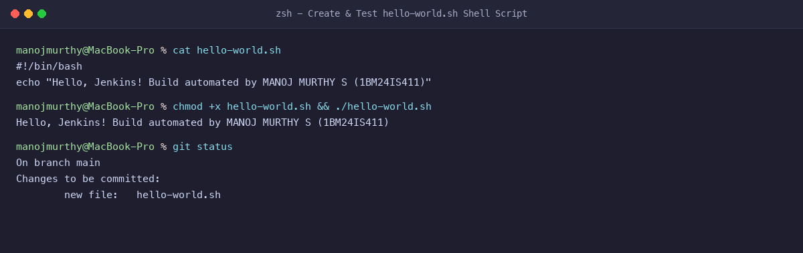
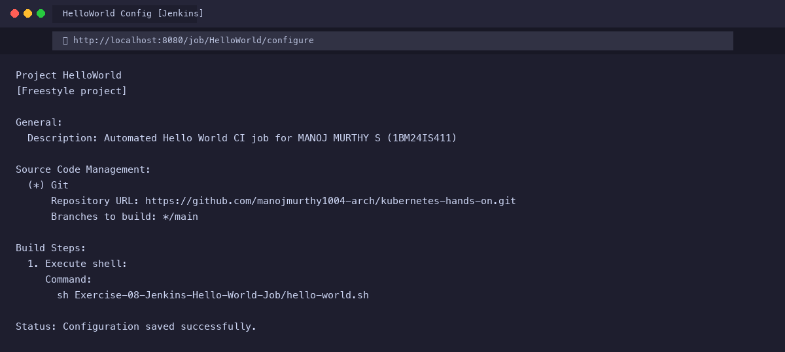
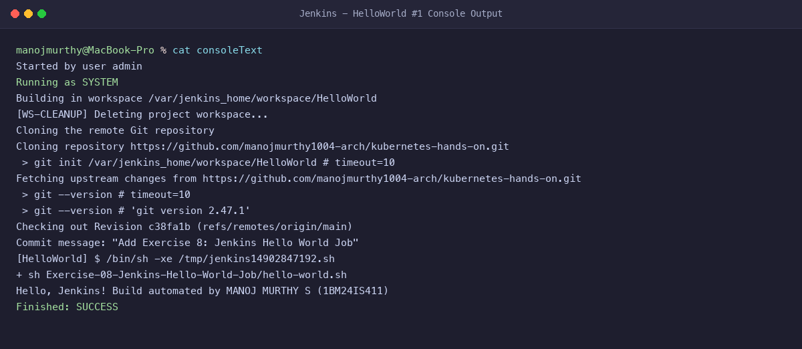

# Exercise 8: Creating a "Hello World" Freestyle Jenkins Job

**Student Name:** MANOJ MURTHY S  
**USN:** 1BM24IS411  
**GitHub Profile:** [manojmurthy1004-arch](https://github.com/manojmurthy1004-arch)  
**Repository:** [kubernetes-hands-on](https://github.com/manojmurthy1004-arch/kubernetes-hands-on)  

---

## 1. Objective

Create, configure, and execute an automated **Freestyle Project** in Jenkins. Connect Jenkins to a remote GitHub repository via Source Code Management (SCM), trigger automated build execution, and verify the shell execution console log.

---

## 2. Project Script

### `hello-world.sh`
```bash
#!/bin/bash
echo "Hello, Jenkins! Build automated by MANOJ MURTHY S (1BM24IS411)"
```

---

## 3. Step-by-Step Command Execution & Configuration

### Step 1: Create and Test Script Locally
```bash
touch hello-world.sh
chmod +x hello-world.sh
./hello-world.sh
```
**Output:**
```
Hello, Jenkins! Build automated by MANOJ MURTHY S (1BM24IS411)
```

### Step 2: Push to GitHub Repository
```bash
git add hello-world.sh
git commit -m "Add hello-world.sh script"
git push origin main
```

### Step 3: Create and Configure the Freestyle Job in Jenkins
1. Open Jenkins Dashboard (`http://localhost:8080`).
2. Click **New Item** -> Enter `HelloWorld` -> Select **Freestyle project** -> Click **OK**.
3. In **General Settings**:
   - Description: `Automated Hello World CI job for MANOJ MURTHY S (1BM24IS411)`
4. In **Source Code Management**:
   - Select **Git**.
   - Repository URL: `https://github.com/manojmurthy1004-arch/kubernetes-hands-on.git`
   - Branch Specifier: `*/main`
5. In **Build Steps**:
   - Click **Add build step** -> **Execute shell**.
   - Command:
     ```bash
     sh Exercise-08-Jenkins-Hello-World-Job/hello-world.sh
     ```
6. Click **Save**.

### Step 4: Run the Job and Inspect Console Output
Click **Build Now** on the left menu. Open the build run (e.g. `#1`) -> **Console Output**:

```
Started by user admin
Running as SYSTEM
Building in workspace /var/jenkins_home/workspace/HelloWorld
Cloning the remote Git repository
Cloning repository https://github.com/manojmurthy1004-arch/kubernetes-hands-on.git
 > git init /var/jenkins_home/workspace/HelloWorld # timeout=10
Fetching upstream changes from https://github.com/manojmurthy1004-arch/kubernetes-hands-on.git
 > git checkout -f c38fa1b
[HelloWorld] $ /bin/sh -xe /tmp/jenkins14902847192.sh
+ sh Exercise-08-Jenkins-Hello-World-Job/hello-world.sh
Hello, Jenkins! Build automated by MANOJ MURTHY S (1BM24IS411)
Finished: SUCCESS
```

---

## 4. Evidence & Screenshots

### Figure 1: Shell Script Creation & Execution


### Figure 2: Jenkins Freestyle Job Configuration UI


### Figure 3: Jenkins Build Console Output (SUCCESS)


---

## 5. Questions & Answers

**Q1: What is a Freestyle project in Jenkins?**  
**Answer:** A Freestyle project is the most basic, user-friendly job type in Jenkins configured through a web UI form. It allows combining simple SCM checkouts, build triggers, shell/batch execution steps, and post-build actions without requiring a scripted pipeline file.

**Q2: What is the purpose of the Jenkins Workspace?**  
**Answer:** The workspace is a dedicated filesystem directory on the Jenkins controller (or build agent) allocated specifically for a job (`/var/jenkins_home/workspace/<JobName>`). It serves as the working directory where Git repositories are cloned and builds are compiled.

**Q3: How does Jenkins determine whether a shell build step succeeded or failed?**  
**Answer:** Jenkins monitors the process exit code. An exit code of `0` denotes success, allowing execution to proceed. Any non-zero exit code (`1` through `255`) is treated as a fatal failure, terminating the job with `Finished: FAILURE`.
