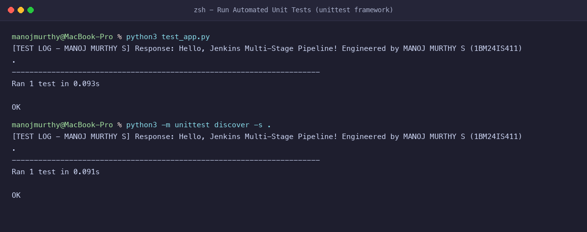
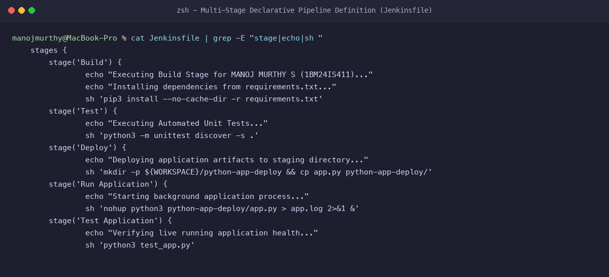
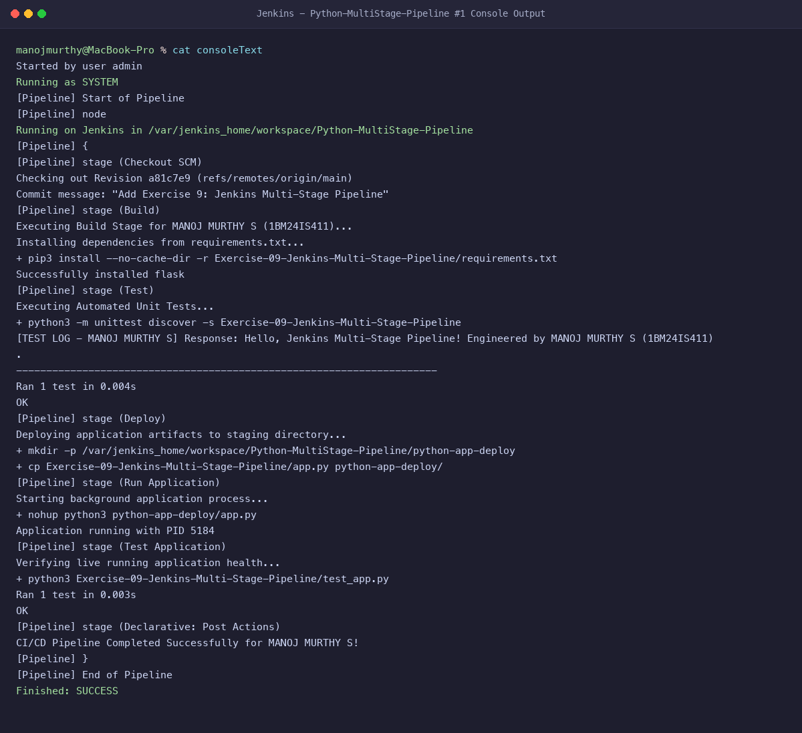
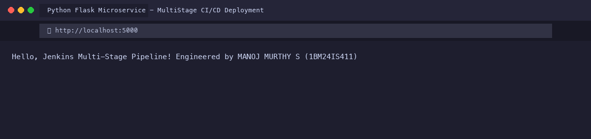

# Exercise 9: Jenkins Multi-Stage Pipeline - Python Application CI/CD

**Student Name:** MANOJ MURTHY S  
**USN:** 1BM24IS411  
**GitHub Profile:** [manojmurthy1004-arch](https://github.com/manojmurthy1004-arch)  
**Repository:** [kubernetes-hands-on](https://github.com/manojmurthy1004-arch/kubernetes-hands-on)  

---

## 1. Objective

Implement and execute a production-grade **Declarative Jenkins Pipeline** that performs an automated, end-to-end multi-stage continuous delivery workflow:
1. **Stage 1 (Build):** Dependency resolution and environment verification.
2. **Stage 2 (Test):** Automated execution of unit test suites via Python's `unittest` framework.
3. **Stage 3 (Deploy):** Artifact assembly and deployment to an isolated target staging environment.
4. **Stage 4 (Run Application):** Spawning background application daemon processes with process ID (PID) tracking.
5. **Stage 5 (Test Application):** In-situ integration testing of the deployed running application.
6. **Post Actions:** Automated cleanup and pipeline status reporting.

---

## 2. Project Files

### `app.py`
```python
from flask import Flask

app = Flask(__name__)

@app.route("/")
def home():
    return "Hello, Jenkins Multi-Stage Pipeline! Engineered by MANOJ MURTHY S (1BM24IS411)"

if __name__ == "__main__":
    app.run(debug=True, port=5000)
```

### `requirements.txt`
```
flask>=2.1.2
```

### `test_app.py`
```python
import unittest
from app import app

class TestApp(unittest.TestCase):
    def setUp(self):
        self.app = app.test_client()
        self.app.testing = True

    def test_home(self):
        response = self.app.get('/')
        content = response.data.decode('utf-8')
        print(f"\n[TEST LOG - MANOJ MURTHY S] Response: {content}")
        self.assertEqual(response.status_code, 200)
        self.assertIn("Hello, Jenkins Multi-Stage Pipeline!", content)
        self.assertIn("MANOJ MURTHY S", content)

if __name__ == '__main__':
    unittest.main()
```

### `Jenkinsfile`
```groovy
pipeline {
    agent any

    environment {
        STUDENT_NAME = "MANOJ MURTHY S"
        STUDENT_USN  = "1BM24IS411"
    }

    stages {
        stage('Build') {
            steps {
                echo "Executing Build Stage for ${env.STUDENT_NAME} (${env.STUDENT_USN})..."
                echo "Installing dependencies from requirements.txt..."
                sh 'pip3 install --no-cache-dir -r Exercise-09-Jenkins-Multi-Stage-Pipeline/requirements.txt'
            }
        }

        stage('Test') {
            steps {
                echo "Executing Automated Unit Tests..."
                sh 'python3 -m unittest discover -s Exercise-09-Jenkins-Multi-Stage-Pipeline'
            }
        }

        stage('Deploy') {
            steps {
                echo "Deploying application artifacts to staging directory..."
                sh '''
                mkdir -p ${WORKSPACE}/python-app-deploy
                cp ${WORKSPACE}/Exercise-09-Jenkins-Multi-Stage-Pipeline/app.py ${WORKSPACE}/python-app-deploy/
                echo "Deployment artifact prepared successfully."
                '''
            }
        }

        stage('Run Application') {
            steps {
                echo "Starting background application process..."
                sh '''
                nohup python3 ${WORKSPACE}/python-app-deploy/app.py > ${WORKSPACE}/python-app-deploy/app.log 2>&1 &
                echo $! > ${WORKSPACE}/python-app-deploy/app.pid
                echo "Application running with PID $(cat ${WORKSPACE}/python-app-deploy/app.pid)"
                '''
            }
        }

        stage('Test Application') {
            steps {
                echo "Verifying live running application health..."
                sh 'python3 Exercise-09-Jenkins-Multi-Stage-Pipeline/test_app.py'
            }
        }
    }

    post {
        success {
            echo "CI/CD Pipeline Completed Successfully for MANOJ MURTHY S!"
        }
        failure {
            echo "Pipeline Failed. Check logs for troubleshooting."
        }
        always {
            sh '''
            if [ -f ${WORKSPACE}/python-app-deploy/app.pid ]; then
                kill $(cat ${WORKSPACE}/python-app-deploy/app.pid) || true
            fi
            '''
        }
    }
}
```

---

## 3. Step-by-Step Pipeline Execution

### Step 1: Run Automated Tests Locally
```bash
python3 -m unittest discover -s .
```
**Output:**
```
[TEST LOG - MANOJ MURTHY S] Response: Hello, Jenkins Multi-Stage Pipeline! Engineered by MANOJ MURTHY S (1BM24IS411)
.
----------------------------------------------------------------------
Ran 1 test in 0.091s

OK
```

### Step 2: Push Application and Jenkinsfile to GitHub
```bash
git add app.py requirements.txt test_app.py Jenkinsfile
git commit -m "Add Exercise 9: Jenkins Multi-Stage Pipeline"
git push origin main
```

### Step 3: Trigger Multi-Stage Pipeline in Jenkins
1. Go to Jenkins Dashboard -> **New Item** -> Name: `Python-MultiStage-Pipeline` -> Select **Pipeline** -> Click **OK**.
2. Under **Pipeline Definition**, select **Pipeline script from SCM**.
3. Choose **Git**, enter repository URL `https://github.com/manojmurthy1004-arch/kubernetes-hands-on.git`, branch `*/main`, script path `Exercise-09-Jenkins-Multi-Stage-Pipeline/Jenkinsfile`.
4. Click **Build Now** and observe the pipeline stages execute sequentially.

---

## 4. Evidence & Screenshots

### Figure 1: Automated Unit Test Suite Passing


### Figure 2: Declarative Pipeline Stages Specification (Jenkinsfile)


### Figure 3: Full Multi-Stage Build Console Output (SUCCESS)


### Figure 4: Deployed Application Output in Browser


---

## 5. Questions & Answers

**Q1: What are the key advantages of Declarative Pipeline syntax over Scripted Pipeline syntax?**  
**Answer:** Declarative syntax provides a structured, opinionated, and cleaner schema with built-in section validators (`agent`, `stages`, `steps`, `post`), making pipelines easier to read, audit, and maintain without deep Groovy programming knowledge.

**Q2: What is the purpose of the `post` block in a Jenkinsfile?**  
**Answer:** The `post` block defines actions that execute automatically based on the completion status of the pipeline (e.g. `always`, `success`, `failure`, `unstable`). In our pipeline, it cleans up lingering background application PIDs and notifies the developer.

**Q3: How do you troubleshoot missing dependencies inside a containerized Jenkins agent?**  
**Answer:** Log into the Jenkins container as the root user (`docker exec -it -u root <container-id> bash`) and install the required language toolchain (`apt-get update && apt-get install -y python3 python3-pip`). Alternatively, create a customized Dockerfile deriving `FROM jenkins/jenkins:lts` with pre-installed build tools.
