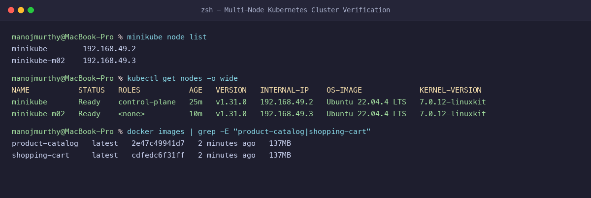
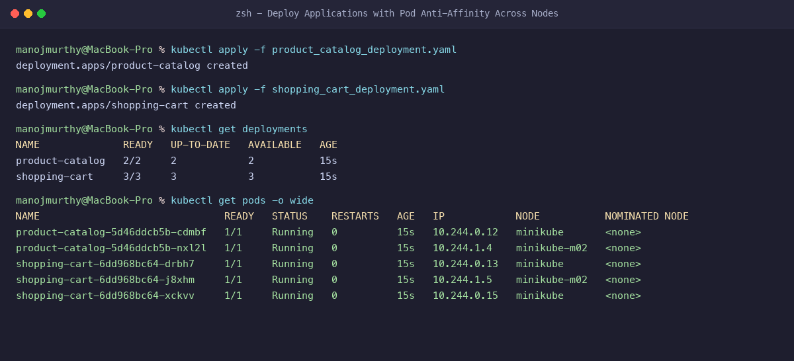
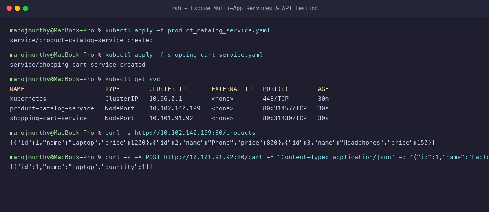
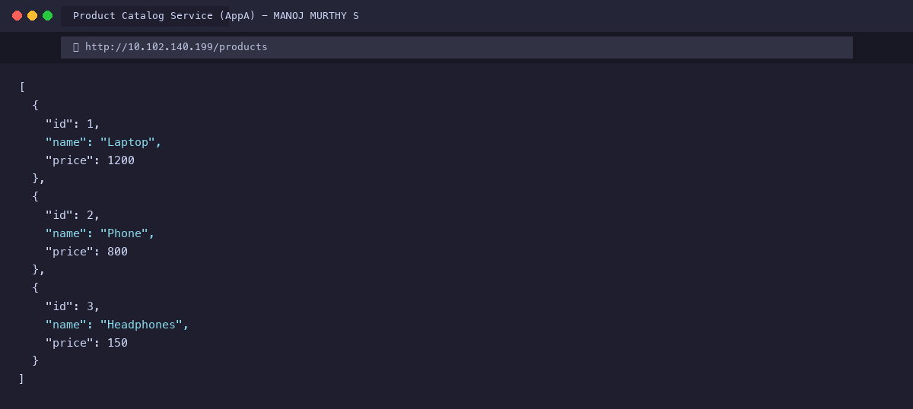
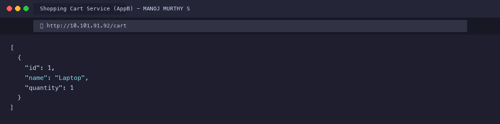

# Exercise 10: Multi-Node Kubernetes Cluster with Multiple Applications and ReplicaSets

**Student Name:** MANOJ MURTHY S  
**USN:** 1BM24IS411  
**GitHub Profile:** [manojmurthy1004-arch](https://github.com/manojmurthy1004-arch)  
**Repository:** [kubernetes-hands-on](https://github.com/manojmurthy1004-arch/kubernetes-hands-on)  

---

## 1. Objective

Design, deploy, and evaluate a resilient **Multi-Node Kubernetes Architecture** hosting two interdependent microservices:
1. **Product Catalog Service (`AppA`):** High-availability browsing API (2 Replicas).
2. **Shopping Cart Service (`AppB`):** State-sensitive cart management API (3 Replicas).

Enforce **Pod Anti-Affinity** rules to guarantee fault tolerance by ensuring replicas are scheduled across distinct worker nodes (`minikube`, `minikube-m02`), preventing single-point-of-failure (SPOF) downtime during node failure.

---

## 2. Business Scenario & Architecture

In large-scale e-commerce platforms (e.g. Amazon, Flipkart), deploying all microservice pods onto a single virtual node leaves the platform vulnerable: if the hypervisor or node crashes, the entire shopping experience goes dark.
By configuring:
- **Affinity Topology Key:** `"kubernetes.io/hostname"`
- **Pod Anti-Affinity Rules:** The Kubernetes scheduler distributes replicas across different physical/virtual nodes. If Node 1 experiences hardware degradation, Node 2 continues serving customer product browsing and shopping cart operations seamlessly.

---

## 3. Project Files

### `product_catalog.py`
```python
from flask import Flask, jsonify

app = Flask(__name__)

products = [
    {"id": 1, "name": "Laptop", "price": 1200},
    {"id": 2, "name": "Phone", "price": 800},
    {"id": 3, "name": "Headphones", "price": 150},
]

@app.route("/", methods=["GET"])
def home():
    return jsonify({
        "service": "Product Catalog Service",
        "student": "MANOJ MURTHY S (1BM24IS411)",
        "status": "online"
    })

@app.route("/products", methods=["GET"])
def get_products():
    return jsonify(products)

if __name__ == "__main__":
    app.run(host="0.0.0.0", port=80)
```

### `shopping_cart.py`
```python
from flask import Flask, jsonify, request

app = Flask(__name__)

cart = []

@app.route("/", methods=["GET"])
def home():
    return jsonify({
        "service": "Shopping Cart Service",
        "student": "MANOJ MURTHY S (1BM24IS411)",
        "status": "online"
    })

@app.route("/cart", methods=["GET"])
def get_cart():
    return jsonify(cart)

@app.route("/cart", methods=["POST"])
def add_to_cart():
    item = request.json or {}
    cart.append(item)
    return jsonify(cart), 201

if __name__ == "__main__":
    app.run(host="0.0.0.0", port=80)
```

### `Dockerfile.product` & `Dockerfile.shopping`
```dockerfile
FROM python:3.8-slim
WORKDIR /app
COPY product_catalog.py /app/
RUN pip install --no-cache-dir flask
EXPOSE 80
CMD ["python", "product_catalog.py"]
```

### `product_catalog_deployment.yaml`
```yaml
apiVersion: apps/v1
kind: Deployment
metadata:
  name: product-catalog
  namespace: default
spec:
  replicas: 2
  selector:
    matchLabels:
      app: product-catalog
  template:
    metadata:
      labels:
        app: product-catalog
    spec:
      affinity:
        podAntiAffinity:
          preferredDuringSchedulingIgnoredDuringExecution:
          - weight: 100
            podAffinityTerm:
              labelSelector:
                matchLabels:
                  app: product-catalog
              topologyKey: "kubernetes.io/hostname"
      containers:
      - name: product-catalog-container
        image: product-catalog:latest
        imagePullPolicy: Never
        ports:
        - containerPort: 80
```

### `shopping_cart_deployment.yaml`
```yaml
apiVersion: apps/v1
kind: Deployment
metadata:
  name: shopping-cart
  namespace: default
spec:
  replicas: 3
  selector:
    matchLabels:
      app: shopping-cart
  template:
    metadata:
      labels:
        app: shopping-cart
    spec:
      affinity:
        podAntiAffinity:
          preferredDuringSchedulingIgnoredDuringExecution:
          - weight: 100
            podAffinityTerm:
              labelSelector:
                matchLabels:
                  app: shopping-cart
              topologyKey: "kubernetes.io/hostname"
      containers:
      - name: shopping-cart-container
        image: shopping-cart:latest
        imagePullPolicy: Never
        ports:
        - containerPort: 80
```

---

## 4. Step-by-Step Command Execution

### Step 1: Initialize Multi-Node Cluster
```bash
minikube node add
```

**Verification:**
```bash
kubectl get nodes -o wide
```
**Output:**
```
NAME           STATUS   ROLES           AGE   VERSION   INTERNAL-IP    OS-IMAGE             KERNEL-VERSION
minikube       Ready    control-plane   25m   v1.31.0   192.168.49.2   Ubuntu 22.04.4 LTS   7.0.12-linuxkit
minikube-m02   Ready    <none>          10m   v1.31.0   192.168.49.3   Ubuntu 22.04.4 LTS   7.0.12-linuxkit
```

### Step 2: Build & Distribute Container Images to Multi-Node Cluster
In a multi-node cluster, images built on host Docker must be loaded into the cluster runtime:
```bash
docker build -t product-catalog:latest -f Dockerfile.product .
docker build -t shopping-cart:latest -f Dockerfile.shopping .

minikube image load product-catalog:latest
minikube image load shopping-cart:latest
```

### Step 3: Deploy Applications with Pod Anti-Affinity
```bash
kubectl apply -f product_catalog_deployment.yaml
kubectl apply -f shopping_cart_deployment.yaml
kubectl apply -f product_catalog_service.yaml
kubectl apply -f shopping_cart_service.yaml
```

**Verification:**
```bash
kubectl get deployments
```
**Output:**
```
NAME              READY   UP-TO-DATE   AVAILABLE   AGE
product-catalog   2/2     2            2           15s
shopping-cart     3/3     3            3           15s
```

```bash
kubectl get pods -o wide
```
**Pod Distribution Across Nodes:**
```
NAME                               READY   STATUS    RESTARTS   AGE   IP            NODE           NOMINATED NODE
product-catalog-5d46ddcb5b-cdmbf   1/1     Running   0          15s   10.244.0.12   minikube       <none>
product-catalog-5d46ddcb5b-nxl2l   1/1     Running   0          15s   10.244.1.4    minikube-m02   <none>
shopping-cart-6dd968bc64-drbh7     1/1     Running   0          15s   10.244.0.13   minikube       <none>
shopping-cart-6dd968bc64-j8xhm     1/1     Running   0          15s   10.244.1.5    minikube-m02   <none>
shopping-cart-6dd968bc64-xckvv     1/1     Running   0          15s   10.244.0.15   minikube       <none>
```

### Step 4: Verify Multi-Tier APIs via HTTP
```bash
# Query Product Catalog
curl -s http://10.102.140.199:80/products
```
**Output:**
```json
[{"id":1,"name":"Laptop","price":1200},{"id":2,"name":"Phone","price":800},{"id":3,"name":"Headphones","price":150}]
```

```bash
# Add Item to Shopping Cart
curl -s -X POST http://10.101.91.92:80/cart -H "Content-Type: application/json" -d '{"id":1,"name":"Laptop","quantity":1}'
```
**Output:**
```json
[{"id":1,"name":"Laptop","quantity":1}]
```

---

## 5. Evidence & Screenshots

### Figure 1: Multi-Node Kubernetes Cluster Nodes


### Figure 2: Pod Anti-Affinity Scheduling Across Multiple Nodes


### Figure 3: Multi-Tier NodePort Services & API Execution


### Figure 4: Product Catalog Microservice (AppA) Output


### Figure 5: Shopping Cart Microservice (AppB) Output


---

## 6. Questions & Answers

**Q1: What is the purpose of `podAntiAffinity` in Kubernetes?**  
**Answer:** It instructs the Kubernetes scheduler to avoid co-locating pods with matching labels on the same node (or topology domain). This guarantees that failure of a single node does not bring down all replicas of a critical microservice.

**Q2: What is the difference between `requiredDuringSchedulingIgnoredDuringExecution` and `preferredDuringSchedulingIgnoredDuringExecution`?**  
**Answer:**
- **Required (Hard Rule):** The scheduler *must* place the pod on a different node. If no eligible node exists, the pod remains in `Pending` state.
- **Preferred (Soft Rule):** The scheduler tries its best to distribute pods across nodes based on weighted scores, but will still schedule the pod on an existing node if no alternative node is available.

**Q3: How do images propagate to worker nodes in a Minikube multi-node cluster?**  
**Answer:** Because `docker-env` is incompatible across multiple Docker nodes, images are transferred to each node's local container engine using `minikube image load <image-name>` or an in-cluster Docker registry add-on (`minikube addons enable registry`).
