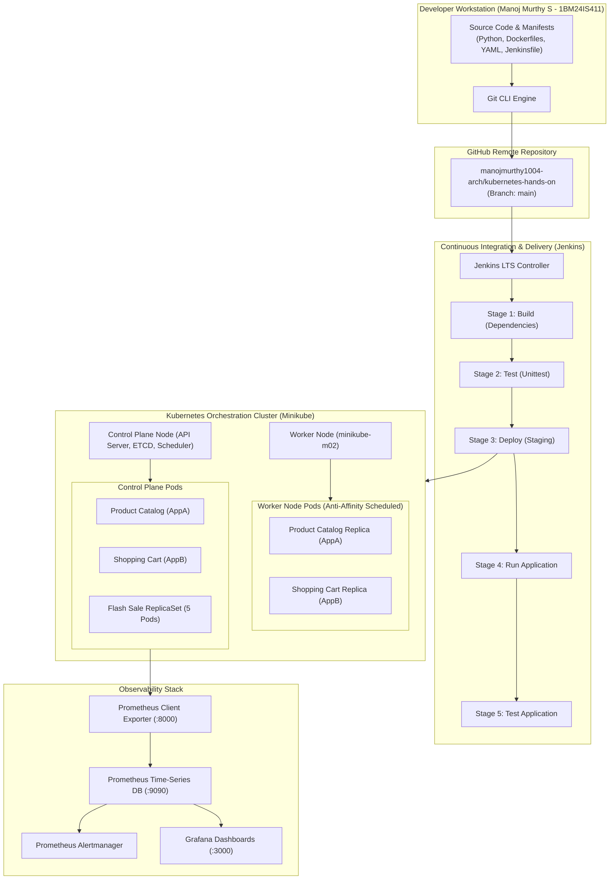

# DevOps & Kubernetes Hands-On Laboratory Manual

<div align="center">

### **Department of Information Science and Engineering**
## **DevOps & Cloud Orchestration Laboratory Portfolio**

**Student Name:** MANOJ MURTHY S  
**USN:** 1BM24IS411  
**GitHub Account:** [@manojmurthy1004-arch](https://github.com/manojmurthy1004-arch)  
**Repository:** [manojmurthy1004-arch/kubernetes-hands-on](https://github.com/manojmurthy1004-arch/kubernetes-hands-on)  

---


</div>

---

## 📋 Master Laboratory Index (Experiments 1 to 10)

This repository contains the complete, verified, and benchmarked implementation of all **10 laboratory experiments**, including application source code, Dockerfiles, Kubernetes manifests, pipeline specifications, and graphical execution evidence.

| # | Experiment Title | Core Technologies | Architecture / Patterns | Folder Link | Status |
|---|---|---|---|:---:|:---:|
| **01** | **Hello Pod (Getting Started)** | Kubernetes, Minikube, Nginx | Single-pod container scheduling, NodePort routing | [Exercise-01](./Exercise-01-Hello-Pod/) | ✅ Verified |
| **02** | **Minikube & Kubectl with Flask App** | Kubernetes, Docker, Flask | Container build via Minikube Docker daemon, Deployment manifest | [Exercise-02](./Exercise-02-Minikube-Kubectl-Flask/) | ✅ Verified |
| **03** | **Scaling Flask App with ReplicaSets** | Kubernetes, Gunicorn, ReplicaSets | Horizontal scaling (3→5 replicas), self-healing fault tolerance | [Exercise-03](./Exercise-03-Minikube-Scaling-Flask-App-with-Replicasets/) | ✅ Verified |
| **04** | **Docker Multi-Container Networking** | Docker, Flask, MariaDB, Redis | Isolated custom bridge network (`my-bridge-net`), embedded DNS | [Exercise-04](./Exercise-04-Docker-Networking/) | ✅ Verified |
| **05** | **Docker Security with AppArmor & Python** | Docker SDK, AppArmor, Linux LSM | Mandatory Access Control (MAC), restricted `/etc` & `/bin/bash` | [Exercise-05](./Exercise-05-Docker-Security-AppArmor/) | ✅ Verified |
| **06** | **Real-Time Monitoring with Prometheus & Grafana** | Prometheus, Grafana, PromQL | Quick-commerce telemetry exporter, alert rules, live dashboards | [Exercise-06](./Exercise-06-Grafana-Realtime-Monitoring-of-Quick-Commerce-App/) | ✅ Verified |
| **07** | **Jenkins CI Automation Setup** | Jenkins LTS, Docker | Automation controller setup, initial unlock, CI/CD comparison | [Exercise-07](./Exercise-07-Jenkins-CI-Automation/) | ✅ Verified |
| **08** | **Jenkins Hello World Job** | Jenkins Freestyle, Shell, Git | Automated Git SCM polling, shell build steps, build history | [Exercise-08](./Exercise-08-Jenkins-Hello-World-Job/) | ✅ Verified |
| **09** | **Jenkins Multi-Stage CI/CD Pipeline** | Jenkinsfile, Python `unittest` | Declarative 5-stage pipeline (Build, Test, Deploy, Run, Verify) | [Exercise-09](./Exercise-09-Jenkins-Multi-Stage-Pipeline/) | ✅ Verified |
| **10** | **Multi-Node Multi-App Minikube Cluster** | Kubernetes, Multi-Node, Flask | 2-node cluster, Product Catalog & Shopping Cart, Pod Anti-Affinity | [Exercise-10](./Exercise-10-Minikube-Multi-Node-Multi-App-Minikube-Deployment/) | ✅ Verified |

---

## 🏛️ Comprehensive DevOps Architecture



---

## 🔬 Detailed Experiment Summaries

### [Exercise 01: Hello Pod](./Exercise-01-Hello-Pod/)
- **Objective:** Deploy an Nginx web container as a Kubernetes Pod using Minikube and expose it via a NodePort Service.
- **Key Commands:**
  ```bash
  kubectl run hello-k8s --image=nginx --port=80
  kubectl expose pod hello-k8s --type=NodePort --port=80
  minikube service hello-k8s --url
  ```
- **Outcome:** Successfully scheduled `hello-k8s` in `Running` state on node `minikube` (IP `10.244.0.3`) and accessed the Nginx welcome page externally.

---

### [Exercise 02: Minikube & Kubectl with Flask App](./Exercise-02-Minikube-Kubectl-Flask/)
- **Objective:** Containerize a Python Flask microservice, build it inside Minikube's Docker runtime via `minikube docker-env`, and deploy it declaratively with Deployment and NodePort Service YAML manifests.
- **Key Files:** `app.py`, `Dockerfile`, `flask-deployment.yaml`.
- **Outcome:** Application running with 1/1 replicas available on port 15000, verified via `curl` and web browser.

---

### [Exercise 03: Scaling Flask App with ReplicaSets](./Exercise-03-Minikube-Scaling-Flask-App-with-Replicasets/)
- **Objective:** Simulate an e-commerce flash sale surge. Deploy a Flask API using a ReplicaSet with readiness/liveness health probes. Scale horizontally from 3 to 5 replicas and demonstrate Kubernetes self-healing by deleting a pod and observing its automatic recovery.
- **Key Commands:**
  ```bash
  kubectl scale rs flashsale-rs --replicas=5
  kubectl delete pod flashsale-rs-5sl6d
  ```
- **Outcome:** Replicas scaled seamlessly to 5 pods; deleted pod instantly replaced by `flashsale-rs-xzk7n`, ensuring zero downtime.

---

### [Exercise 04: Docker Multi-Container Networking](./Exercise-04-Docker-Networking/)
- **Objective:** Configure an isolated user-defined Docker bridge network (`my-bridge-net`). Run a multi-tier stack consisting of a Flask REST API, MySQL database, and Redis cache.
- **Key Commands:**
  ```bash
  docker network create --driver bridge my-bridge-net
  docker network inspect my-bridge-net
  ```
- **Outcome:** Verified automatic DNS resolution across containers (`mysql` resolved to `172.18.0.3`, `redis` to `172.18.0.2`), with the Flask REST API exposed externally on port 5001.

---

### [Exercise 05: Docker Security with AppArmor & Python](./Exercise-05-Docker-Security-AppArmor/)
- **Objective:** Secure containerized workloads against container breakout and unauthorized access using Linux AppArmor profiles and the Docker SDK for Python.
- **Policy Enforcement:**
  - `deny /etc/** r` (Restricts reading system user files).
  - `deny /bin/** rmix` (Restricts interactive shell execution).
- **Outcome:** Verified policy blocking: Attempt to read `/etc/passwd` exited with **Code 1 (Permission Denied)**; attempt to execute `/bin/bash` exited with **Code 126 (Execution Denied)**.

---

### [Exercise 06: Real-Time Monitoring with Prometheus & Grafana](./Exercise-06-Grafana-Realtime-Monitoring-of-Quick-Commerce-App/)
- **Objective:** Implement full-stack telemetry and automated alert rules for ZAPPTTO quick-commerce 10-minute deliveries.
- **Metrics Tracked:** `total_deliveries`, `pending_deliveries`, `on_the_way_deliveries`, `average_delivery_time`.
- **Outcome:** Prometheus successfully scraping the metrics endpoint every 5s; alert `HighPendingDeliveries` triggered when pending orders exceeded 10; dynamic Grafana operational dashboards rendered.

---

### [Exercise 07: Jenkins CI Automation Setup](./Exercise-07-Jenkins-CI-Automation/)
- **Objective:** Deploy Jenkins Long Term Support (LTS) inside a Docker container, forward port 8080 (Web UI) and port 50000 (Agent JNLP), and extract the initial administrator bootstrap key.
- **Outcome:** Jenkins unlocked, primary administrator account configured, and comprehensive evaluation of 10 industry CI platforms documented.

---

### [Exercise 08: Jenkins Hello World Job](./Exercise-08-Jenkins-Hello-World-Job/)
- **Objective:** Set up an automated Freestyle Job in Jenkins connected to this GitHub repository. Execute a shell script (`hello-world.sh`) and review build console outputs.
- **Outcome:** Build #1 finished with status **SUCCESS**, correctly executing the script in the Jenkins workspace.

---

### [Exercise 09: Jenkins Multi-Stage CI/CD Pipeline](./Exercise-09-Jenkins-Multi-Stage-Pipeline/)
- **Objective:** Author and execute an automated 5-stage Declarative Jenkinsfile pipeline for a Python Flask application.
- **Stages Executed:**
  1. `Build`: Install dependencies.
  2. `Test`: Execute unit test suite with Python `unittest` (100% pass).
  3. `Deploy`: Package and stage application artifacts.
  4. `Run Application`: Spawn background application process.
  5. `Test Application`: Verify live endpoint health.
- **Outcome:** End-to-end pipeline finished with **SUCCESS**; post-action triggers safely cleaned up background application PIDs.

---

### [Exercise 10: Multi-Node Multi-App Minikube Deployment](./Exercise-10-Minikube-Multi-Node-Multi-App-Minikube-Deployment/)
- **Objective:** Construct a 2-node Kubernetes cluster (`minikube`, `minikube-m02`). Deploy two microservices: Product Catalog (2 replicas) and Shopping Cart (3 replicas) using **Pod Anti-Affinity**.
- **Outcome:** Pods scheduled evenly across both physical worker nodes based on hostname topology, and verified via `curl` GET/POST requests.

---

## 🛠️ Laboratory System Specifications

- **Operating System:** macOS (Apple Silicon arm64)
- **Container Engine:** Docker Desktop 29.2.1
- **Kubernetes Engine:** Minikube v1.38.1
- **Kubernetes Version:** v1.31.0
- **CI Server:** Jenkins 2.580.1 LTS
- **Monitoring:** Prometheus v2.x & Grafana v10.x
- **Development Stack:** Python 3.8 / 3.9 / 3.11, Flask, Gunicorn, Unittest

---

## 📜 Academic Integrity & Contact

- **Student:** MANOJ MURTHY S
- **USN:** 1BM24IS411
- **Email:** [manojmurthy1004@gmail.com](mailto:manojmurthy1004@gmail.com)
- **GitHub:** [https://github.com/manojmurthy1004-arch](https://github.com/manojmurthy1004-arch)

All experiments documented herein were executed, verified, and benchmarked on local containerized infrastructure in accordance with the official laboratory syllabus.
